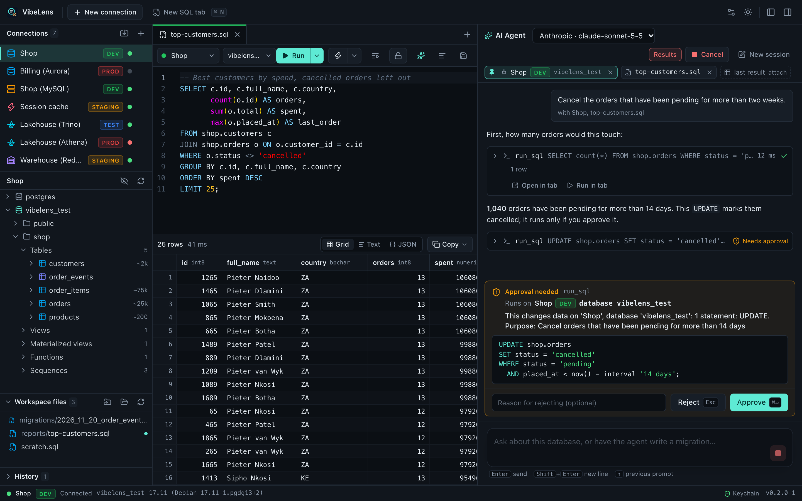
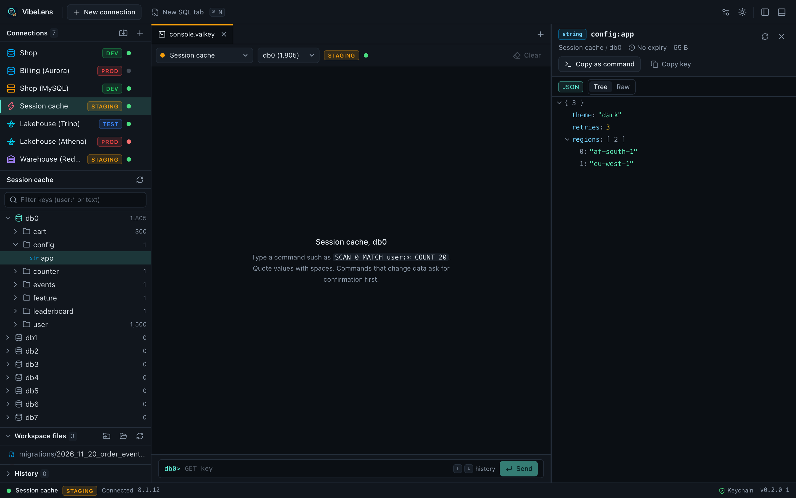
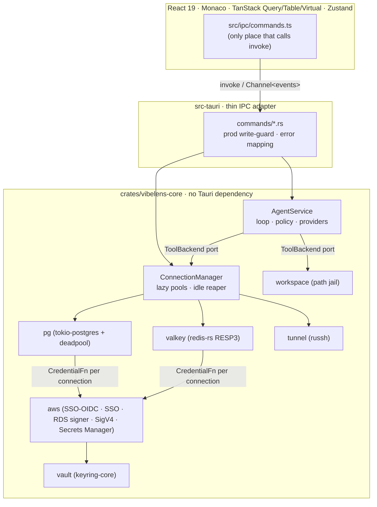

<div align="center">


# VibeLens

**An AI-first desktop client for PostgreSQL, Valkey and Apache Iceberg, built for teams whose data lives inside private AWS VPCs.**

Native Rust core · Tauri v2 shell · an agent that can read your schema and write your migrations, and that can't run a write unless you approve it. Or switch the AI off entirely: **Classic** mode is a fast, normal database client.

[](LICENCE.md)


-lightgrey)
[](.github/workflows/ci.yml)

<br/>



<sub>The agent read the schema (allowed under <b>Schema only</b>), explained its plan, and is <b>waiting for approval</b> before writing the migration.</sub>

</div>

---

## Why VibeLens?

Most database GUIs were built for a world of static passwords and public endpoints. Today's production databases are **Aurora Serverless behind a bastion, authenticated with 15-minute IAM tokens, reached through an SSO session**. The usual workaround is a pile of shell scripts to mint tokens and open tunnels.

VibeLens makes that path native, and adds an agent that does real work (inspecting the schema, writing a migration into a `.sql` file, explaining a slow query) under rules the agent can't override.

|                      | Typical DB GUI | VibeLens |
|----------------------|:---:|:---:|
| AWS IAM Identity Center (SSO) sign-in, account and role picker | – | ✅ |
| RDS / Aurora IAM auth, minted per connection | plugin or script | ✅ built in |
| Secrets Manager ARN as the credential | – | ✅ in-memory only |
| ElastiCache (Valkey) IAM auth | – | ✅ |
| Apache Iceberg: REST, Glue, S3 Tables, SQL catalogs; local engine or Athena | – / separate tool | ✅ |
| Works with the AI switched off (Classic mode) | ✅ | ✅ |
| SSH bastion tunnel with host-key pinning | ✅ | ✅ |
| Idle disconnect so Serverless can scale to zero | – | ✅ |
| AI agent with tool use and an approval gate | – / chat box | ✅ agentic loop |
| Per-connection control over what the AI may *see* | – | ✅ |
| Binary size and memory | JVM / Electron | Tauri (system webview) |

---

## Highlights

### 🐘 PostgreSQL
- Lazy schema navigator: databases → schemas → tables, views, matviews, functions, sequences → columns, with PK, FK and index detail.
- Monaco editor with `pgsql` highlighting. **⌘/Ctrl+Enter** runs the statement under the cursor (or the selection); **⌘/Ctrl+⇧+Enter** runs the whole script.
- Results **stream** in 500-row pages into a grid virtualized in both directions, so 100k × 50 stays smooth. Queries are cancellable.
- **Exact numbers:** `int8`, `numeric` and `money` arrive as strings, never rounded through a JS double.
- A **production write-guard**: on a `prod` connection, writes and DDL need you to type the connection name.
- Tuned for scale-to-zero: 30s connect timeout to cover Aurora Serverless v2 or Neon resuming, and pools dropped after 5 minutes idle.

### ⚡ Valkey / Redis OSS
- Key browser built on `SCAN` (never `KEYS`), with a namespace tree (`user:883:auth` → `user / 883 / auth`), lazily paged.
- Typed inspectors for strings (JSON auto-detected), hashes, lists, sets, sorted sets, streams and RedisJSON.
- A console with history and quoting-aware parsing. **Write detection asks the server** (`COMMAND INFO` flags) instead of trusting a hard-coded list, so new commands are classified correctly.
- RESP3 throughout. One connection per logical DB (no shared `SELECT` state). Cluster mode scans every primary.
- TLS is done by VibeLens's own rustls config, so the client can dial a tunnel's local port and still verify the real ElastiCache hostname.



### 🧊 Apache Iceberg
- **Catalogs:** Iceberg **REST** (Polaris, Lakekeeper, Nessie, Gravitino, …) with no auth, a bearer token or OAuth2 client credentials; **AWS Glue**; **Amazon S3 Tables**; the **SQL/JDBC** catalog (SQLite or Postgres); Hive Metastore in builds with the `iceberg-hms` feature.
- **AWS identity everywhere:** Glue and S3 Tables use the same SSO / profile / IAM role as the rest of the app. Temporary credentials are refreshed before they expire.
- **Two engines:**
  - **Local:** embedded Apache DataFusion that reads the Parquet files directly. Nothing is billed. It supports SELECT, joins and aggregates, `INSERT` (append), `CREATE TABLE`/CTAS, **time travel** (`shop."orders@<snapshot-id|branch|tag|timestamp>"`) and metadata tables (`"orders$snapshots"`, `"orders$manifests"`).
  - **Athena** (Glue / S3 Tables): full `UPDATE`/`DELETE`/`MERGE` and Lake Formation enforcement. Every result shows data scanned and an **≈ cost estimate** at list price.
- **Table explorer:** schema with field IDs and nested types, partition spec and sort order, snapshot timeline with "query as of this snapshot", data preview, and **expire snapshots** behind a confirmation.
- **S3-compatible storage** (MinIO, R2, Ceph) with your own endpoint. It overrides whatever endpoint the catalog advertises, so a REST catalog that says `http://minio:9000` still works from your laptop.

### ☁️ AWS, natively
- **Your existing `~/.aws/config` profiles just work**: SSO, `sso-session`, assume-role chains, `credential_process`.
- Or **sign in with IAM Identity Center** inside the app: device code, browser opens, then pick an account and role. The token is cached in the same CLI-compatible format, so the `aws` CLI sees it too.
- **RDS IAM tokens** are signed for the real endpoint, per new physical connection. RDS checks the token only at connect time, so there's no refresh loop to babysit.
- **Secrets Manager**: paste an ARN; the secret is fetched at connect time, held as a zeroizing `SecretString`, and **never crosses into the UI**.
- **ElastiCache IAM** for Valkey/Redis OSS 7+ (replication groups and Serverless), with transparent re-auth after the service's 12-hour connection limit.

### 🧭 Use it your way: Classic, Assist or Agent-first
On first run you pick a mode. Change it any time in Settings or the command palette.
- **Classic:** no AI anywhere: no agent panel, no inline AI, no AI buttons, and no traffic to any model provider. A fast, keyboard-driven database client.
- **Assist** (default): the agent panel is a ⌘J away; ⌘K inline AI, "Fix with AI" on errors and "Explain with AI" on plans.
- **Agent-first:** the agent sits beside the editor and drives; you review and approve.

### 🛠️ Editor and data tools
- **Explain visualiser:** plan tree, cost hot spots, row misestimates and other insights. "Explain with AI" redacts literal values unless the connection allows results.
- **Table tab:** server-side filter and sort; edit cells, insert and delete rows; review the generated SQL; apply in one transaction with row-count checks.
- **ER diagram** of a schema (⌘⇧E) with SVG export. **Query history** with secrets redacted; prod connections aren't recorded.
- **Export** CSV / TSV / JSON / SQL / Markdown, with spreadsheet formula injection defused. Files are written owner-only.
- **Command palette:** ⌘P go to anything, ⌘⇧P commands. Schema-aware autocomplete and hover.
- **Unsaved work is safe:** ⌘W closes a tab, and closing the window or ⌘Q with unsaved tabs asks first. That check runs natively, so it holds even if the UI has crashed.

### 🤖 The agent
A real tool-use loop in Rust, not a text-to-SQL box. The agent can list connections, read schema metadata, describe tables, run SQL, scan and read Valkey keys, and read and write files in your workspace.

```text
you › Add a soft-delete column to orders and backfill it safely. Save it as a migration.

agent › calling get_schema(main_db, public)                         ✓ 38 tables · 41 ms
agent › calling run_sql  SELECT count(*) FROM orders WHERE …        ✓ 1 row · 12 ms
agent › wants to write_file migrations/2026_10_31_orders_soft_delete.sql
        ┌ approval required ─────────────────────────────────────────┐
        │ + ALTER TABLE orders ADD COLUMN deleted_at timestamptz;      │
        │ + CREATE INDEX CONCURRENTLY … WHERE deleted_at IS NULL;     │
        └───────────────────────────── [Approve ⌘↵]  [Reject Esc] ───┘
agent › Written. Review it in the new tab; it batches the backfill in 10k-row chunks…
```

- **Providers:** Anthropic (native Messages API) or any OpenAI-compatible endpoint: xAI Grok, Gemini's OpenAI-compatible endpoint, or a **local model through Ollama / LM Studio / vLLM**, so nothing leaves your machine. Model IDs are configuration, not code.
- API keys live in the **OS keychain**.

---

## 🔒 Security model

> **Production-honest summary:** the approval gate and the read-only transaction are enforced in Rust. SQL classification is a routing hint. **Your real boundary is a least-privilege database role.**

**What the agent may *see***, set per connection:

| AI data access | What can leave your machine |
|---|---|
| `none` | Nothing. The agent's tools refuse this connection. |
| `schemaOnly` *(default)* | Catalog metadata: table and column names, types, indexes, key names. **No rows, no values.** |
| `resultsWithApproval` | Rows and values, but every call that reads data asks you first. |
| `results` | Rows and values from read-only calls, without asking. |

**What the agent may *do***:

| Action | Behaviour |
|---|---|
| `SELECT`, `SHOW`, `EXPLAIN` | Runs inside `BEGIN READ ONLY` with a snapshot already taken, so the server rejects any write, and `SET TRANSACTION READ WRITE` is refused. `COMMIT`/`ROLLBACK` are blocked inside the read-only run. |
| `INSERT`/`UPDATE`/`DELETE`/DDL/unparseable SQL | **Approval required**, with the SQL shown. Prod connections are flagged in red. |
| Valkey writes (per the server's `COMMAND INFO`), `EVAL`/`FCALL` | **Approval required.** |
| Valkey admin commands (`CONFIG`, `ACL`, `KEYS`, `CLIENT`, `MONITOR`, …) | **Always denied** to the agent. `CONFIG GET *` can return `requirepass`. |
| Writing a workspace file | **Always** needs approval, with a unified diff preview. |
| Files outside the workspace, `..`, symlink escapes | Impossible: path jail, extension allowlist, 5 MiB cap. |


**Where secrets live:**

| Secret | Stored |
|---|---|
| Passwords, SSH keys' passphrases, LLM API keys | macOS Keychain / Windows Credential Manager |
| Secrets Manager values, IAM DB tokens | Process memory only (zeroized on drop), never sent to the UI |
| SSO access token | `~/.aws/sso/cache/*.json`, **plaintext, exactly like the AWS CLI** |
| Connection profiles | `profiles.json` in the app config dir. No secrets: passwords, tokens and keys are not part of a profile, and a save is refused if a header or a catalog URI carries one. |

Also: a strict CSP, Tauri capabilities limited to `core:default` (plus opening `https://` links), TLS verify-full by default (with the RDS CA bundle), and pinned SSH host keys: a key is never trusted silently, and no credential is sent to a host whose key you have not checked.

**Prompt injection, honestly.** Tool output is fed back to the model framed as untrusted data, and a write needs your approval. But `READ ONLY` is not a sandbox: functions such as `dblink`, `pg_read_file`, `lo_export`, `pg_terminate_backend` and session-level advisory locks still work inside a read-only transaction. VibeLens routes any SELECT that calls a known side-effecting function to approval, and classification **fails closed**: anything it can't positively prove read-only goes to approval. That list is still a denylist. A least-privilege role is what actually contains a determined injection (see below).

<details>
<summary><b>Recommended: a read-only role for agent use</b></summary>

```sql
CREATE ROLE vibelens_agent LOGIN;
GRANT rds_iam TO vibelens_agent;                       -- RDS IAM auth (or set a password)
GRANT CONNECT ON DATABASE main_db TO vibelens_agent;
GRANT USAGE ON SCHEMA public TO vibelens_agent;
GRANT SELECT ON ALL TABLES IN SCHEMA public TO vibelens_agent;
ALTER DEFAULT PRIVILEGES IN SCHEMA public GRANT SELECT ON TABLES TO vibelens_agent;
ALTER ROLE vibelens_agent SET default_transaction_read_only = on;
ALTER ROLE vibelens_agent SET statement_timeout = '30s';
```
Then make a second profile for that role and point the agent at it.
</details>

---

## Architecture



The core is a **ports-and-adapters** crate. Every service depends on traits (`SecretVault`, `ProfileStore`, `CredentialSource`, `TunnelProvider`, `ToolBackend`), so the engines are tested headless against real Postgres and Valkey in CI, and the agent loop is tested against a mock LLM server. Full rationale, including every deviation from the original spec, is in **[docs/DESIGN.md](docs/DESIGN.md)**.

---

## Getting started

### Prerequisites
| | macOS | Windows |
|---|---|---|
| Rust (stable, via [rustup](https://rustup.rs)) | `curl --proto '=https' --tlsv1.2 -sSf https://sh.rustup.rs \| sh` | `winget install Rustlang.Rustup` |
| Build tools | `xcode-select --install` | Visual Studio Build Tools ("Desktop development with C++") |
| Webview | built in (WKWebView) | WebView2 (preinstalled on Windows 10/11) |
| Node.js | 24 | 24 |

### Run it: macOS, one command
```bash
git clone https://github.com/heinM/VibeLens.git && cd VibeLens/VibeLens
./scripts/dev-mac.sh            # installs Rust if needed, Node 24 via nvm, starts seeded Postgres + Valkey, launches the app
```
It starts Postgres on `localhost:55432` (`postgres` / `vibelens`, with a demo `shop` schema of 25k orders) and Valkey on `localhost:56379` (about 1,800 sample keys). Pass `--no-db` to skip Docker.

### Run it: manually
```bash
git clone https://github.com/heinM/VibeLens.git && cd VibeLens/VibeLens
npm install
./scripts/fetch-rds-ca.sh        # Windows: scripts\fetch-rds-ca.ps1 — needed for TLS to RDS/Aurora
npm run tauri dev
```

### Build installers
```bash
npm run tauri build              # → src-tauri/../target/release/bundle/{dmg,macos,msi,nsis}
```
Unsigned by default. Signing, notarisation, Windows certificates (and what they cost from South Africa), auto-update and the tag-triggered release workflow (`.github/workflows/release.yml`) are covered in **[docs/RELEASING.md](docs/RELEASING.md)**. What to test before sharing a build: **[docs/TEST_PLAN.md](docs/TEST_PLAN.md)**. Logo and app-icon brief: **[docs/LOGO_SPEC.md](docs/LOGO_SPEC.md)**.

---

## Connecting to AWS

<details>
<summary><b>RDS / Aurora with IAM authentication</b></summary>

1. Enable IAM DB authentication on the instance or cluster.
2. In the database: `CREATE USER app_ro; GRANT rds_iam TO app_ro;`
3. Allow your role `rds-db:connect` on `arn:aws:rds-db:<region>:<account>:dbuser:<DbiResourceId or cluster-ResourceId>/app_ro`.
4. In VibeLens: **Auth → RDS IAM**, username `app_ro`, pick your AWS profile or Identity Center role, and set the region. Leave TLS on **Verify full** and tick **Trust Amazon RDS CA bundle**.
</details>

<details>
<summary><b>Secrets Manager</b></summary>

**Auth → Secrets Manager**, then paste the secret ARN. RDS-managed secret JSON (`username`, `password`, `host`, `port`, `dbname`) is understood; host, port and database from the secret fill in anything the profile leaves blank. Your role needs `secretsmanager:GetSecretValue`, plus `kms:Decrypt` if the secret uses a customer-managed key.
</details>

<details>
<summary><b>ElastiCache for Valkey with IAM</b></summary>

Create an IAM-enabled user (`--authentication-mode Type=iam`), add it to the cache's user group, and allow `elasticache:Connect` on both the cache and the user. In-transit encryption must be on. In VibeLens: **Auth → ElastiCache IAM**, with the user id, the replication-group or serverless-cache name, and the region.
</details>

<details>
<summary><b>Apache Iceberg on Glue, S3 Tables and Athena</b></summary>

New connection → **Apache Iceberg**. Pick a catalog, an AWS identity (SSO profile or Identity Center role) and an engine.

| Engine | Read needs | Writes also need |
|---|---|---|
| Local, Glue catalog | `glue:GetDatabase(s)`, `glue:GetTable(s)`; `s3:GetObject`, `s3:ListBucket` on the table locations | `glue:UpdateTable`, `s3:PutObject` |
| Local, S3 Tables | `s3tables:ListNamespaces`, `ListTables`, `GetTable`, `GetTableMetadataLocation`, `GetTableData` | `s3tables:PutTableData`, `UpdateTableMetadataLocation` |
| Athena | the above for its catalog, plus `athena:StartQueryExecution`, `GetQueryExecution`, `GetQueryResults`, `StopQueryExecution`, `GetWorkGroup`, and S3 write on the results location | Lake Formation grants, if LF governs the tables |

The local engine reads the files with **your** credentials, so Lake Formation column and row filters don't apply there; Athena enforces them. Give the Athena workgroup a **per-query data-scanned limit**: the cost shown in VibeLens is an estimate (US$5/TB list price, 10 MB minimum), not a cap.
</details>

<details>
<summary><b>Private VPC via SSH bastion</b></summary>

**Network → SSH tunnel**: bastion host, user, and ssh-agent, key file or password. The first time you connect or test, VibeLens shows the host key fingerprint and sends nothing to the server (no user name, key or password) until you have checked it and chosen to trust it. You can also paste the fingerprint into the connection up front. A later mismatch is refused. VibeLens forwards a random local port and still verifies TLS against the real database hostname.
</details>

---

## Where things live

| What | macOS | Windows |
|---|---|---|
| Profiles and provider config | `~/Library/Application Support/com.heinvandermerwe.vibelens/` | `%APPDATA%\com.heinvandermerwe.vibelens\` |
| Worksheets (agent-writable) | `~/Documents/VibeLens/` | `Documents\VibeLens\` |
| Secrets | Keychain, service `com.heinvandermerwe.vibelens` | Credential Manager, same name |

Override the workspace with `VIBELENS_WORKSPACE=/path`.

## Keyboard shortcuts
| | |
|---|---|
| Run statement / selection | ⌘/Ctrl + Enter |
| Run script | ⌘/Ctrl + ⇧ + Enter |
| Save worksheet | ⌘/Ctrl + S |
| New SQL tab | ⌘/Ctrl + N |
| Toggle sidebar / agent panel | ⌘/Ctrl + B / ⌘/Ctrl + J |
| Approve / reject agent action | ⌘/Ctrl + Enter / Esc |

---

## Development

```text
.
├── .github/workflows/          ← CI and multi-platform releases
├── docs/                       ← architecture, release and test plans
└── VibeLens/                   ← desktop application
    ├── Cargo.toml              ← Rust workspace
    ├── crates/vibelens-core/   ← engine logic (no Tauri dependency)
    ├── src-tauri/              ← IPC commands, app state, config
    └── src/                    ← React app (ipc/, store/, components/, hooks/)
```

```bash
docker compose -f docker-compose.dev.yml up -d
export VG_TEST_PG="host=127.0.0.1 port=55432 user=postgres password=vibelens dbname=vibelens_test"
export VG_TEST_VALKEY=redis://127.0.0.1:56379
cargo test -p vibelens-core     # engines, AWS signing, agent loop vs mock LLM
npm run typecheck && npm test   # frontend
```

**Contract rule:** `crates/vibelens-core/src/model/*.rs` ⇄ `src/ipc/types.ts`, and `src-tauri/src/lib.rs` ⇄ `src/ipc/commands.ts`. Change both sides in the same commit.

---

## Known limitations (V1)
- **Valkey cluster mode doesn't work through an SSH tunnel** (`MOVED` redirects point at node IPs). Use a VPN-routable network, or a non-cluster endpoint.
- **No SSM Session Manager port forwarding yet**; it's the top V1.1 item.
- Identity Center sign-in uses the **device-code** grant. Authorization code + PKCE (the AWS CLI's current default) is planned.
- Results are capped at `maxRows` (100k by default) rather than using server-side cursors.
- A single value over 1 MiB (Postgres, local Iceberg engine) is shown cut, with its real size. It cannot be edited, and copies and exports carry a note instead of it. To read more of it, select a part with SQL (`substr`, `->>`). There is no "load full value" yet.
- Linux builds run but have no keychain backend; secrets are kept in memory only, and the app shows a warning.
- **Windows** builds compile in CI but haven't had a manual test pass yet. Treat the first Windows release as a beta.
- **Iceberg, local engine:**
  - No row-level `UPDATE`/`DELETE`/`MERGE` (iceberg-rust 0.10 can't write delete files yet); use an Athena connection for DML.
  - No views listed.
  - `uuid` columns display as bytes.
  - No bytes-scanned statistic.
  - It reads S3 directly, so **Lake Formation permissions are not applied**; use Athena for LF-governed tables.
- **Iceberg SQL catalogs** created by pyiceberg or Java's default JDBC schema lack a nullable `iceberg_type` column that the Rust catalog needs. VibeLens adds it automatically **only on connections marked dev**. Elsewhere it tells you the one `ALTER TABLE` for the catalog's owner to run.
- **Athena** results and cost come from real AWS APIs, but VibeLens's Athena integration has so far been tested against a mock endpoint, not a live account. Set a per-query data-scanned limit on the workgroup you use.

## Roadmap
**Done since V1:** interface modes · query history · exports · ERD · explain visualiser · table editing · Apache Iceberg + Athena
**V1.1:** SSM port forwarding · PKCE SSO · auto-update · Parquet export · Iceberg row-level deletes on the local engine (once iceberg-rust supports them)
**V1.2:** MySQL / Aurora MySQL · DynamoDB (read-only) · audit log · shareable profile packs (no secrets)

---

## Licence

VibeLens is source-available under the **[VibeLens Source-Available Licence 1.0](LICENCE.md)**:

| Use | Allowed? |
|---|---|
| **Personal use** by an individual (learning, hobby projects, personal evaluation) | ✅ Free |
| **Any use by or for a company, business or other organisation**, including against its systems or data, or in providing services | 💼 Needs a paid commercial licence **or** explicit written approval from the author |
| **Using, or forking, VibeLens to work with Microsoft SQL Server or Oracle Database** | 🍷 Prohibited, unless you deliver a case of **Domaine de la Romanée-Conti, Romanée-Conti 2015**, unspoiled, and the author confirms receipt in writing |

Each version converts to **Apache 2.0** on its Change Date (31 October 2036, or earlier if announced), and the restrictions above then lapse for that version. For commercial licensing, open an issue or contact the author via GitHub.

<sub>Built with Tauri, Rust and React. PostgreSQL, Valkey, Redis, AWS and the AI providers named here are trademarks of their respective owners; VibeLens is not affiliated with or endorsed by them.</sub>
